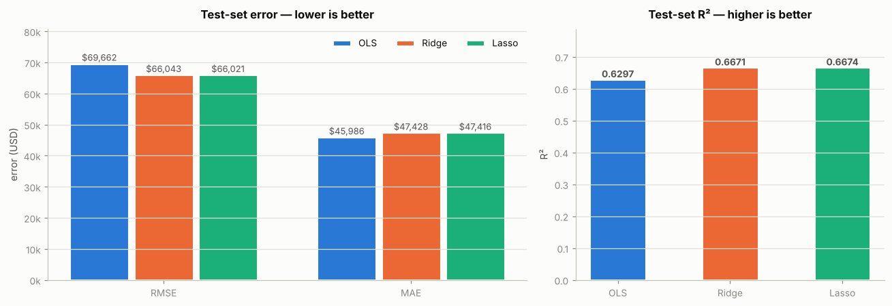
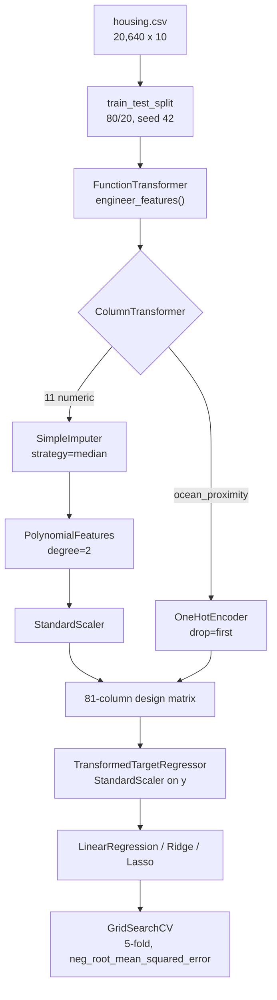
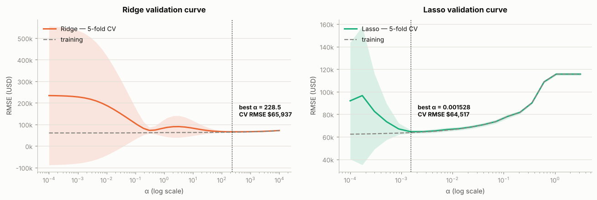
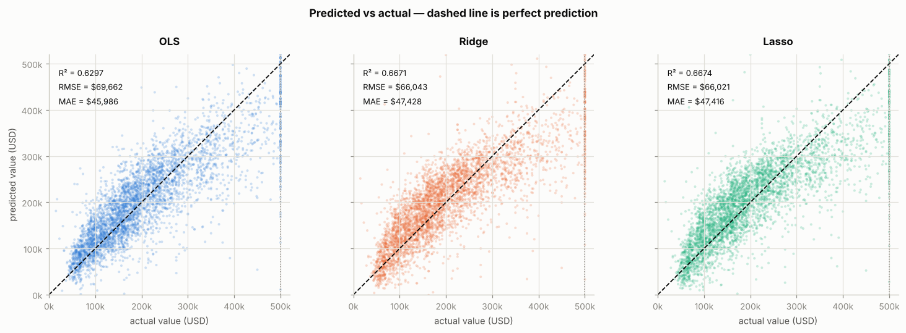
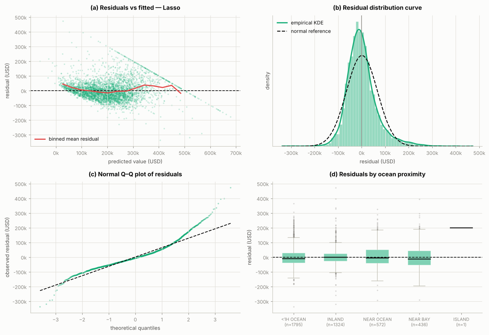

# California Housing Price Prediction — OLS vs Ridge vs Lasso

Continuous regression modelling on the California Housing dataset (20,640 districts),
comparing **Ordinary Least Squares**, **Ridge (L2)** and **Lasso (L1)** regression under
severe multicollinearity. Includes feature engineering, pipeline-safe imputation,
hyperparameter tuning with `GridSearchCV`, and full residual error analysis.

Built as part of the **Datheon** Machine Learning & Data Science internship.

---

## Results

All metrics are on a held-out 20% test set (4,128 districts) never used for tuning.
Model selection was done on 5-fold cross-validated RMSE.

| Model | Test RMSE | Test MAE | Test R² | Train R² | R² gap | α | Features used |
|---|---|---|---|---|---|---|---|
| OLS | $69,662 | **$45,986** | 0.6297 | 0.7241 | 0.0944 | — | 81 / 81 |
| Ridge (L2) | $66,043 | $47,428 | 0.6671 | 0.6930 | 0.0259 | 228.55 | 81 / 81 |
| **Lasso (L1)** | **$66,021** | $47,416 | **0.6674** | 0.6958 | 0.0284 | 0.001528 | **37 / 81** |

Both penalised models cut roughly **$3,600 (5.2%)** off OLS test RMSE and reduced the
train/test R² gap by about 70%. Lasso matched Ridge's accuracy using fewer than
half the features.



### The headline finding is counter-intuitive

**OLS has the lowest MAE, and is slightly more accurate than Ridge and Lasso across almost
the entire error distribution** — at the median, at the 90th percentile and even at the
99th:

| Absolute error | p50 | p90 | p99 | Worst miss |
|---|---|---|---|---|
| OLS | $32,900 | **$95,798** | **$218,340** | **$1,655,197** |
| Ridge | $35,491 | $99,905 | $228,823 | $466,862 |
| Lasso | $35,419 | $100,518 | $225,735 | $472,227 |

So where did OLS lose $3,600 of RMSE? In a handful of districts beyond the 99th
percentile. Its worst single prediction is off by **$1.66 million** — larger than any
actual house value in the dataset — and its five worst districts alone contribute
**17.4% of its total squared error**. On that same worst district, Lasso is off by only
about $5,000.

**Regularisation did not make typical predictions better here. It made catastrophic
predictions impossible**, by refusing to let collinear features carry enormous cancelling
weights (largest OLS coefficient: 27.8 standardised units, versus 0.30 for Ridge).

Whether that trade is worth a slightly higher typical error depends on the cost of a
single large mistake. For property valuation it usually is, which is why RMSE — not MAE —
is the right metric to select on.

---

## Installation

Requires Python 3.9+.

```bash
# 1. Clone
git clone https://github.com/<your-username>/california-housing-ridge-lasso.git
cd california-housing-ridge-lasso

# 2. Create and activate a virtual environment
python -m venv .venv
source .venv/bin/activate        # Windows: .venv\Scripts\activate

# 3. Install dependencies
pip install -r requirements.txt
```

The dataset is committed at `data/housing.csv` (1.4 MB), so the project runs offline.
If it is missing, `src/data.py` downloads it automatically from the
[public source](https://raw.githubusercontent.com/ageron/handson-ml2/master/datasets/housing/housing.csv)
and caches it there.

## Usage

**Run the full comparison from the command line:**

```bash
python -m src.train              # full run, ~2m 10s (the Lasso grid dominates)
python -m src.train --quick      # coarse alpha grids, ~25s smoke test
python -m src.train --no-plots   # metrics only
python -m src.train --data /path/to/housing.csv
```

This prints the metric table and diagnostics, writes `reports/metrics.csv`, and
regenerates all four figures in `reports/figures/`.

**Or work through the annotated notebook:**

```bash
jupyter notebook notebooks/housing_price_ridge_lasso.ipynb
```

The notebook is the narrative version — 31 code cells with EDA, correlation heatmap, VIF
analysis, validation curves, coefficient interpretation and residual diagnostics, each
with written commentary. All outputs are committed, so it reads without being run.

> **Note on runtime.** The Lasso grid takes about two minutes. Coordinate descent
> converges slowly on a design matrix this collinear — that is expected, not a hang.

---

## Architecture

### Project layout

```
.
├── README.md
├── requirements.txt
├── LICENSE
├── data/
│   └── housing.csv                      # dataset (auto-downloaded if absent)
├── notebooks/
│   └── housing_price_ridge_lasso.ipynb  # annotated end-to-end analysis
├── reports/
│   ├── metrics.csv                      # generated metric table
│   └── figures/                         # generated PNGs
└── src/
    ├── config.py      # paths, constants, feature lists  (single source of truth)
    ├── data.py        # dataset loading, local-first with URL fallback
    ├── features.py    # layer 1: domain ratio features
    ├── pipeline.py    # layer 2: preprocessing + model construction
    ├── evaluate.py    # metrics, coefficient and residual diagnostics
    ├── plots.py       # figures, with one fixed colour per model
    └── train.py       # CLI entry point: orchestrates the comparison
```

Each module has a single responsibility, and `train.py` is the only one that knows about
the others. Swapping in a different estimator means one line in `train.py`; changing the
feature set means one list in `config.py`.

### Modelling pipeline



Every parameter learned from data — the imputation median, the standardisation mean and
scale, the one-hot vocabulary — lives **inside** the pipeline. Cross-validation therefore
refits the entire chain on each fold's own training portion, so nothing leaks from the
validation split into training. Fitting the imputer on the full dataset before splitting
is the most common silent mistake in this kind of project, and the pipeline structure
makes it impossible.

### Three design decisions worth explaining

**1. Why a degree-2 interaction expansion?**
With only the original features (20 columns against 16,512 training rows),
cross-validation drives α to essentially zero — the penalty does nothing and the three
models are indistinguishable. The expansion to 81 heavily overlapping features creates the
high-dimensional, collinear regime where L1 and L2 actually differ, and it satisfies the
interaction-engineering requirement at the same time.

**2. Why standardise the target?**
Penalties act on coefficient magnitude, so the useful range of α depends on the scale of
`y`. With the target in raw dollars (σ ≈ $115,000) the penalty is negligible unless α is
enormous, and the validation curve flattens into uselessness. Wrapping the estimator in
`TransformedTargetRegressor` puts α on a conventional scale and places both optima safely
inside their grids. The transformer inverts automatically, so **all predictions and
metrics come back in dollars.**

**3. Why are the two α values not comparable?**
scikit-learn scales the penalties differently: `Ridge` minimises `‖y−Xβ‖² + α‖β‖²` while
`Lasso` minimises `(1/2n)‖y−Xβ‖² + α‖β‖₁`. The `1/2n` factor makes Lasso's optimal α
numerically far smaller (0.0015 vs 228.5). Only each α's **position within its own grid**
is meaningful — which is why the validation curves below are drawn as two panels rather
than on a shared axis.

---

## Methodology

### 1. Data quality

- **207 missing values** in `total_bedrooms` (1.00% of rows), median-imputed inside the
  pipeline. The median is used rather than the mean because the room counts are heavily
  right-skewed.
- **The target is censored at $500,001** for 965 districts (4.68%). No model can predict
  past a ceiling it cannot see, which puts a hard floor under achievable RMSE and produces
  the long right tail in the residual distribution.
- `ocean_proximity` has only **5 `ISLAND` records**, so no conclusion rests on that
  category.

### 2. Feature engineering

The four raw district-size counts (`total_rooms`, `total_bedrooms`, `population`,
`households`) correlate with **each other** at r = 0.86–0.98 while carrying almost no
signal about price (|r| ≤ 0.14). Normalising them fixes both problems at once:

| Engineered feature | Definition | r with target |
|---|---|---|
| `bedrooms_per_room` | `total_bedrooms / total_rooms` | −0.256 |
| `rooms_per_household` | `total_rooms / households` | +0.152 |
| `population_per_household` | `population / households` | −0.024 |

`bedrooms_per_room` reaches r = −0.256 where `total_bedrooms` itself sits at +0.050.
These 3 ratios plus the 8 original numeric columns are then expanded to 77 polynomial
terms, and `ocean_proximity` adds 4 one-hot columns: **81 features total**.

### 3. Multicollinearity

Variance Inflation Factors on the 11 pre-expansion numeric features put the count block
in the tens-to-hundreds (VIF > 10 is conventionally severe), and `longitude`/`latitude`
are also heavily inflated by their mutual r = −0.925.

Rather than dropping features arbitrarily, the collinearity is handled by penalisation:
Ridge's `α‖β‖²` term makes `(XᵀX + αI)` invertible and stable even when `XᵀX` is
near-singular, while Lasso selects one member of each collinear group and zeroes the rest.

**Lasso independently reproduced the VIF diagnostic.** Of the 44 features it discarded,
nearly all are products among the four redundant count columns — `total_rooms ×
total_bedrooms`, `population × households`, `households²` — exactly the block VIF flagged.
Of the 12 features containing `median_income`, it kept 9.

### 4. Hyperparameter tuning

| | Grid | Values | Best α | Position |
|---|---|---|---|---|
| Ridge | `np.logspace(-4, 4, 40)` | 40 | 228.55 | interior |
| Lasso | `np.logspace(-4, 0.5, 20)` | 20 | 0.001528 | interior |

5-fold `KFold(shuffle=True, random_state=42)`, scored on `neg_root_mean_squared_error`.
Both optima sit inside their grids rather than at an edge, confirming the ranges were wide
enough.



Both curves show the textbook U shape. At small α the penalty is inert, training error is
minimal and CV error is high — overfitting. Past the optimum both errors climb together as
coefficients are squeezed toward zero. The dashed training line rising to meet the
validation line is the bias–variance trade-off made visible.

---

## Residual error analysis




The remaining error is **structural, not a tuning problem**. Four findings:

1. **Regression toward the mean.** Grouped into deciles of actual value, the model
   over-predicts the cheapest decile by about $17,000 and under-predicts the dearest by
   about $99,000, moving monotonically from one end to the other. A linear form — even
   carrying every pairwise interaction — cannot bend to the true price surface.

2. **Heteroscedasticity.** Residual SD grows from roughly $43,000 in the second fitted
   decile to about $85,000 in the top one. Breusch–Pagan: LM = 93.6, p ≈ 4e−22. Point
   predictions remain usable, but ordinary standard errors would be understated.

3. **A right-skewed, heavy-tailed residual distribution** (skewness +1.04, excess kurtosis
   +3.91). The right tail is the censored districts: since residual = actual − predicted
   and the model cannot predict past the cap, those districts carry large *positive*
   residuals, averaging +$102,000 and reaching +$472,000.

4. **Unmodelled curvature.** Mean residual against fitted value is U-shaped, not flat:
   about +$29,000 in the lowest fitted decile, −$17,000 through the middle, +$20,000 at
   the top.

Residual medians by `ocean_proximity` fall within about $13,000 of zero for all four
substantial categories — small against a residual SD near $66,000 — so the one-hot
encoding is doing its job and no geographic group is badly mispriced.

### Known limitations

- All three models produce a few impossible negative predictions (12 for OLS, 7 each for
  Ridge and Lasso) — unavoidable when an unbounded linear function models a strictly
  positive quantity.
- The $500,001 cap limits achievable accuracy and cannot be fixed by modelling.
- `ISLAND` has one record in the test split and cannot be evaluated.

### Where the next gain would come from

- Model `log(median_house_value)` to stabilise the variance and rule out negative
  predictions.
- Treat the censored districts separately, or use a censored-regression (Tobit) model.
- Compare against a gradient-boosted tree ensemble, which captures the non-linear
  geographic structure without being told which interactions to build.

---

## Reproducibility

`random_state=42` is fixed for the train/test split, the CV folds and both estimators, so
every number in this README is reproducible by running `python -m src.train`.

Verified with Python 3.13, numpy 2.5.3, pandas 3.0.5, scikit-learn 1.9.1, scipy 1.18.1,
statsmodels 0.15.0 and matplotlib 3.11.2. `requirements.txt` specifies lower bounds rather
than exact pins; the code uses no version-specific APIs.

## Tech stack

Python · scikit-learn (`LinearRegression`, `Ridge`, `Lasso`, `Pipeline`,
`ColumnTransformer`, `GridSearchCV`, `TransformedTargetRegressor`) · pandas · numpy ·
statsmodels (VIF, Breusch–Pagan) · scipy · matplotlib

## License

[MIT](LICENSE)
